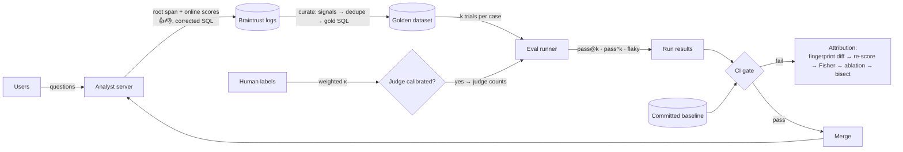

# Eval Flywheel Platform

Most teams stop at "I ran evals once". This repo is the **data flywheel** as a working system, built around a small text-to-SQL analyst agent:



| Capability | Where | What it does |
|---|---|---|
| **Production traces → golden dataset** | `server/tracing.ts`, `flywheel/curate/` | Every turn is a Braintrust root span with online scores. User feedback attaches to it. Curation ranks traces by signal, dedupes with embeddings, derives *validated* gold SQL and promotes a stratified batch. |
| **LLM judge calibrated against humans** | `evals/scorers/judge.ts`, `flywheel/label/`, `flywheel/judge/` | Blind terminal labeling. Reports quadratic-weighted Cohen's κ (with bootstrap CI), confusion matrix and pass/fail TPR/TNR on a held-out split. The judge only counts once κ ≥ 0.6. |
| **pass@k and pass^k** | `flywheel/run.ts`, `flywheel/metrics/` | Every case runs k times. Reports the unbiased pass@k, pass^k, per-scorer std across trials, flaky cases and bootstrap CIs. |
| **"Which change caused the drop?"** | `flywheel/attribution/` | Fingerprint diff across 8 components. Separates measurement changes from behavior changes, flags significant per-case drops, then ablates (and optionally bisects) to name the cause. |
| **Evals gate CI** | `flywheel/gate/`, `.github/workflows/` | A keyless mock gate on every PR, a real-model gate when secrets exist, a sticky PR comment, and a nightly curation PR. |

Everything also runs **without API keys** (`--mock`). Deterministic mock models implement the AI SDK model spec, so the *real* agent loop, tools, SQL, scorers, gate and attribution run in tests and in CI on forks.

---

## Quick start

Requires Node ≥ 22.13 (uses built-in `node:sqlite`).

```bash
npm install
```

```bash
npm run db:seed
```

```bash
npm test
```

Keyless tour (deterministic mock models):

```bash
npm run eval -- --mock --k 5
```

```bash
npm run simulate -- --mock && npm run curate -- --mock --dry-run
```

With real models, copy `.env.example` to `.env` and set `OPENAI_API_KEY`. Add `BRAINTRUST_API_KEY` for traces and experiments.

```bash
npm run serve
```

Open http://localhost:8787, ask questions, and give 👍/👎 or correct the SQL.

---

## The system under test

A **text-to-SQL analyst** (`agent/`) answers business questions over a seeded SQLite e-commerce DB (`db/`: customers, products, categories, orders, order items, reviews, about 9k rows). It uses four tools: `listTables`, `describeTable`, `runQuery` (read-only, single statement, row cap) and `submitAnswer({sql, answer})`.

Text-to-SQL was chosen because correctness can be **executed**: the agent's result set is compared to a gold query's result set. That gives exact pass/fail, which is what makes pass@k vs pass^k and run-to-run variance clear. The DB seed is deterministic, so gold results are identical on every machine.

The golden dataset (`evals/datasets/golden.jsonl`) starts with 32 hand-written cases across filter, join, aggregate, window, date, ambiguous (several acceptable interpretations) and unanswerable (the agent must decline).
- **24 regression cases:** must keep passing; hard-gated.
- **8 capability cases:** hard; we're trying to improve these.

### Scorers

| Scorer | Type | Pass rule |
|---|---|---|
| `executes` | code | final SQL ran (read-only enforced) |
| `resultMatch` | code | result set equals gold (or any acceptable interpretation); row order, column names/order, extra columns and display rounding ignored |
| `answerGrounded` | code | the plain-English answer states the gold result's key values (≥ 0.8) |
| `refusal` | code | unanswerable questions are declined, not fabricated |
| `efficiency` | code | informational only (steps vs budget) |
| `judge` | LLM | answer is faithful, answers the question, flags assumptions (≥ acceptable). **Only counted once calibrated** |

A trial **passes** when every applicable rule holds (`flywheel/config.ts → pass`).

---

## The flywheel, step by step

### 1. Production traces

`server/tracing.ts` logs each `/api/ask` as a root span named `analyst-turn`. The span carries:
- **Input and output:** the question; the SQL, answer and first rows.
- **The run fingerprint:** prompt, tools, model and code hashes.
- **Online scores:** computed with no gold answer: `executes`, `nonempty_result`, `submitted`, `efficiency`.

`wrapAISDK` makes LLM and tool calls child spans. `POST /api/feedback` attaches 👍/👎 (`user_rating`) and corrected SQL (`expected`) to the span with `logger.logFeedback`. Corrected SQL is validated (read-only, must execute) before it is accepted.

Without a Braintrust key, the same records go to `traces/*.jsonl` and everything downstream reads them the same way. `npm run simulate` sends a 42-question pool (paraphrases, new questions, ambiguous, unanswerable) through the traced entry point, tagged `source=simulated`. It fabricates no feedback.

### 2. Auto-curation (`npm run curate`)

```
pull (BTQL / local) → classify by signal → dedupe (embeddings) → gold SQL → stratified promote
```

- **Signals, strongest first:** user correction › 👎 › SQL error › empty result › no submit › slow › 👍 › random 10% coverage sample.
- **Dedupe:** cosine ≥ 0.92 against golden + this batch, with `text-embedding-3-small` and an on-disk cache.
- **Gold SQL comes from**, in order:
  1. the user's correction (enters as `status: reviewed`)
  2. the agent's own SQL on a 👍 turn
  3. a stronger model's draft using the shared business glossary

  Every gold query is **executed**. Failing or empty results are rejected, never guessed.
- **Promotion:** at most 10 cases per run, round-robin across query kinds so one failure mode can't flood the set. Cases go to `golden.jsonl` and the Braintrust dataset `SQL Analyst Golden`.
- **Safety valve:** new cases enter as `suite: capability`. Unless a human supplied the gold, they're `status: candidate`. Candidates run in every eval but **never gate CI** until someone accepts them with `npm run curate:review`, which can also graduate them to the regression suite.
- **Nightly:** `.github/workflows/curate-nightly.yml` curates the last 24h of traces and opens a PR with the new cases and a signal summary.

### 3. k-trial evals (`npm run eval`)

Each case runs `k` times (default 5 locally, 3 in CI). With `BRAINTRUST_API_KEY`, this is one Braintrust experiment (`trialCount: k`). Experiment metadata carries the fingerprint and git info, and `pass` is logged as a score next to each scorer. Results are always written to `results/<runId>.json` with every trial's output, so later steps never re-run the agent.

- **pass@k** = 1 − C(n−c, k) / C(n, k): can it ever get this right? This is the unbiased estimator from Chen et al. 2021, averaged over cases.
- **pass^k** = C(c, k) / C(n, k): does it get it right every time? This is the reliability number users feel.
- **Flaky cases** are those with 0 < passes < trials. Bootstrap 95% CIs are computed over cases.

The gap between pass@k and pass^k is the run-to-run variance that a single eval run hides.

### 4. Judge calibration

1. `npm run label` shows recorded answers **without the judge's verdict** (no anchoring), sampled across the judge's grade buckets. You grade 1–4, and labels append to `labels/human.jsonl`, keyed by output hash, with a snapshot of what was judged.
2. `npm run judge:calibrate` runs the judge on every labeled output and reports exact agreement, within-one agreement, **quadratic-weighted κ** with a bootstrap CI, the confusion matrix, and binary TPR/TNR at the "acceptable" cut. Each is computed **separately for the dev split** (tune the judge prompt here) and **the held-out test split** (the number you trust). Output: `reports/judge-calibration.{json,md}`.
3. The judge counts in pass/fail and the gate only when held-out κ ≥ 0.6 on ≥ 20 labels, **for this exact judge**. Calibration is keyed to the judge prompt + model hash, so editing the judge prompt automatically un-trusts it until you recalibrate.

### 5. Regression attribution (`npm run attribute`)

1. **Fingerprint diff.** Each of `prompt · tools · model · agentCode · dbSchema · dataset · scorers · judge` is hashed per run.
2. **Dataset isolation.** Only shared cases are compared. Newly curated (often harder) cases are listed separately, so they never read as a regression.
3. **Measurement vs behavior.** The base run's recorded outputs are re-scored with the current scorers, gold and judge. base → base′ is the *measurement* effect; base′ → head is the *agent behavior* effect.
4. **Per-case significance.** A one-sided Fisher exact test on passes/trials. With k=3, the most extreme drop (3/3 → 0/3) has p = 0.05 exactly, so the threshold is p ≤ 0.05.
5. **Ablation.** For changed `prompt`, `tools` or `model`, the regressed cases are re-run with *one* component reverted to the base run's version (the stored prompt text, tool descriptions and model id). The tool reports which revert recovers the score.
6. **Bisect (`--bisect`).** For code or schema changes, or multi-commit ranges, it runs `git bisect run` with an eval of only the regressed cases at each step.

Example from the keyless mock: the business glossary was deleted from the system prompt and the change gated against the baseline.

```
# Eval gate: ❌ FAILED
| Regression reliability (pass^3)          | ❌ | 70.8% of regression cases passed all 3 trials (min 85.0%)
| Per-case regressions (regression suite)  | ❌ | `rev-monthly-2025` 5/5→0/3 (p=0.018), `rev-q4-2024` 5/5→0/3 (p=0.018)
| Scorer means (regression suite)          | ❌ | resultMatch 0.97→0.79, answerGrounded 0.98→0.83
| Capability pass@1                        | ❌ | 75.0% → 45.8%

## Regression attribution
> Agent behavior -18.8 pts: 3 case(s) regressed significantly (1 join, 2 date), mostly on
> resultMatch (0.92 → 0.69). Ablation: reverting **prompt** recovers +100.0 pts of the -100.0 pts
> drop on the regressed cases → the prompt change is the **likely cause**.
Changed components: **prompt** · ~~tools~~ · ~~model~~ · ~~agentCode~~ · ...
| Base outputs, re-scored with head's scorers/gold/judge | 90.6% (measurement effect +0.0 pts) |
```

The report also shows the failing SQL next to the passing SQL: the status filter became `WHERE 1 = 1`. `tests/pipeline.test.ts` checks that ablation still blames the prompt, not the model, when **both** change. It also checks that a gold-SQL edit is attributed to measurement, not to the agent.

### 6. CI gate

`.github/workflows/ci.yml`:

- **Every PR, no secrets:** typecheck → unit and pipeline tests → mock eval → gate vs `reports/baseline.mock.json` → attribution on failure → job summary.
- **When `OPENAI_API_KEY` is set:** a real eval (k=3; logged to Braintrust if `BRAINTRUST_API_KEY` is set), then the gate vs `reports/baseline.json`, then attribution on failure. Results are posted as a sticky PR comment, uploaded as artifacts, and the job fails if the gate failed.

Gate rules (`flywheel/config.ts → gate`):

| Rule | Population | Default |
|---|---|---|
| pass^3 ≥ threshold (estimated from however many trials ran) | reviewed regression cases | 85% |
| no significant per-case drop vs baseline | reviewed regression cases | Fisher p ≤ 0.05 |
| scorer mean drop ≤ threshold | reviewed regression cases | executes 0.05, resultMatch 0.08, … |
| pass@1 drop ≤ threshold | reviewed capability cases | 10 pts |
| never gated | candidates (unreviewed curated cases) | n/a |
| judge counted only if calibrated | all | κ ≥ 0.6 |

**Baselines are committed on purpose.** `npm run baseline:update` (or `-- --mock`) rewrites `reports/baseline[.mock].json`, including per-trial outputs, which attribution needs. Commit it in the PR, so every baseline move is reviewed. The first real run has no `reports/baseline.json`, so the real gate reports with a warning until you create one.

---

## Commands

| Command | Purpose |
|---|---|
| `npm run db:seed` | Build `db/shop.sqlite` deterministically |
| `npm run serve` | Analyst UI + API on :8787 (`MOCK=1` for the mock model) |
| `npm run simulate -- [--mock] [--n 42] [--repeat 2]` | Send the question pool through the traced entry point |
| `npm run eval -- [--mock] [--k 5] [--ci] [--suite regression] [--kind join] [--ids a,b] [--no-judge] [--no-send] [--out f]` | k-trial eval → `results/`, `reports/latest.md` |
| `npm run baseline:update -- [--mock] [--run results/x.json]` | Promote a run (or a fresh one) to the committed baseline |
| `npm run gate -- [--head f] [--base f] [--report f] [--report-only]` | Pass/fail vs baseline (exit 1 on fail) |
| `npm run attribute -- [--head f] [--base f] [--no-ablate] [--bisect]` | Explain the difference between two runs |
| `npm run curate -- [--mock] [--source braintrust\|local] [--since ISO] [--dry-run]` | Traces → new golden cases |
| `npm run curate:review` | Accept / edit / reject / graduate candidate cases |
| `npm run label -- [--run f] [--n 20] [--labeler you]` | Blind human labeling for judge calibration |
| `npm run judge:calibrate -- [--mock]` | Judge-vs-human agreement report |

## Configuration

`.env` (see `.env.example`): `OPENAI_API_KEY`, `BRAINTRUST_API_KEY`, `BRAINTRUST_PROJECT` (default `SQL Analyst`), and optional `AGENT_MODEL` / `JUDGE_MODEL` / `DRAFTER_MODEL` / `EMBEDDING_MODEL`. All thresholds live in `flywheel/config.ts`. For CI, add `OPENAI_API_KEY` and `BRAINTRUST_API_KEY` as repository secrets.

## Repo layout

```
agent/       analyst: prompt (+ shared business glossary), tools, loop, read-only DB access
db/          schema + deterministic seed
evals/       golden dataset, code scorers, LLM judge
server/      Hono API + UI, Braintrust/local tracing, feedback
flywheel/    run (k trials), metrics, judge calibration, labeling, curation, attribution, gate, mock models, CLI
scripts/     traffic simulator + question pool
reports/     committed baselines; generated reports
labels/      human labels (committed)
tests/       unit + end-to-end (mock) tests
```

## Status and known limits

- **Verified here, keyless:**
  - Typecheck and 63 tests: statistics against hand-computed values, the SQL guard, scorers, curation, calibration, server and feedback, and end-to-end gate + attribution on the mock.
  - Braintrust `Eval` with `trialCount` (run with `noSendLogs`), and `wrapAISDK` passing calls through on AI SDK v7.
- **Not yet verified with real keys:**
  - Real OpenAI runs. The default model ids are `gpt-5.4-mini` (agent) and `gpt-5.4` (judge, drafter); override them in `.env`.
  - Braintrust experiment and dataset uploads, BTQL trace pulls, and whether `wrapAISDK` produces child spans on AI SDK v7.
  - First real run: `npm run simulate`, then `npm run curate`, then `npm run eval`, then check the Braintrust project.
- **Mock embeddings are lexical** (hashing trick). They catch near-verbatim repeats, not paraphrases. Semantic dedupe needs the real embedding model.
- **The mock agent is a test double, not a benchmark.** Its failure rates are chosen so that variance, attribution and the gate can be demonstrated offline.
- **Labels must come from people.** `labels/human.jsonl` starts empty, and the judge stays "reported only" until you label about 40 answers.
